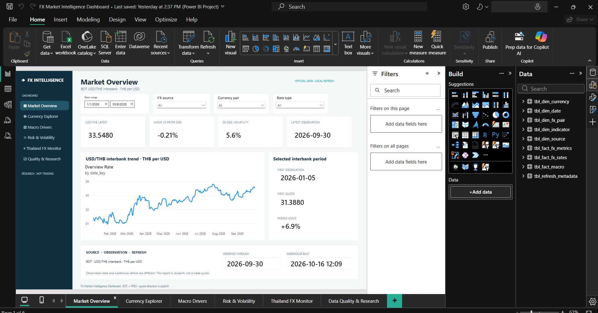
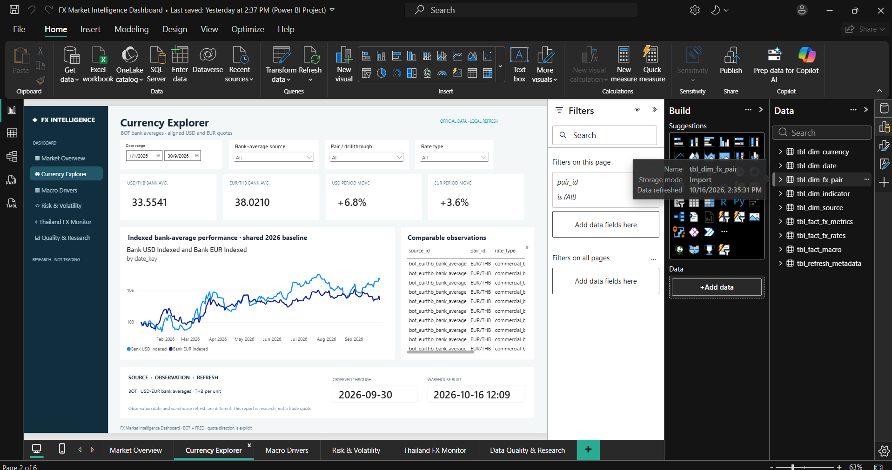
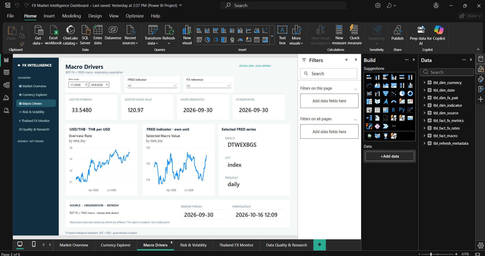
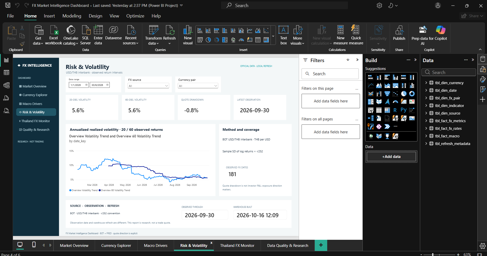
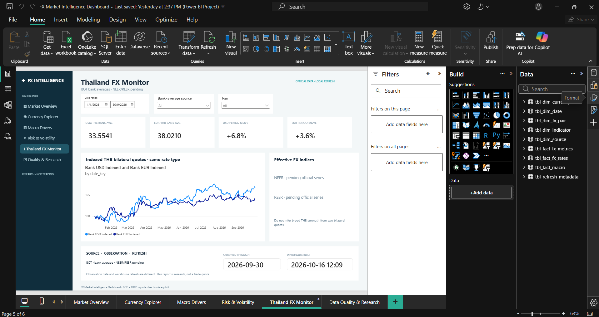
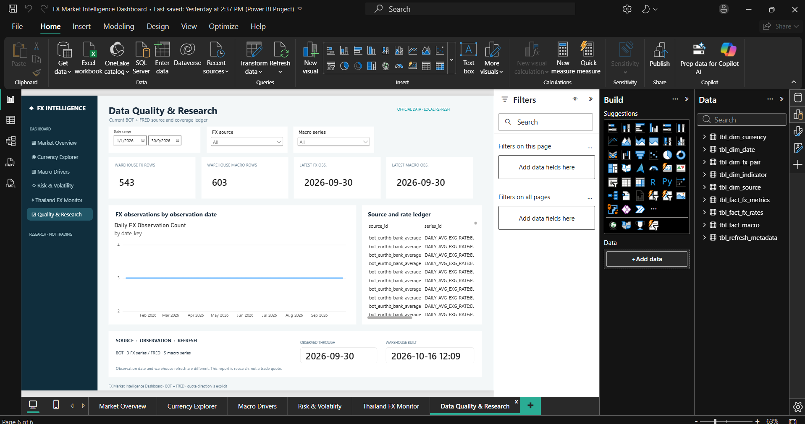

# FX Market Intelligence: Reading USD/THB Moves and Knowing What the Data Can Support

An analytics pipeline and six-page Power BI report built on official Bank of Thailand (BOT) exchange rates and FRED macroeconomic series. It shows how USD/THB and EUR/THB moved in 2026, how risky that move was, and which conclusions the data can and cannot support.

**Tools:** Python (pandas, NumPy, Pandera) · DuckDB (SQL) · Power BI (DAX) · pytest · Ruff · GitHub Actions
**Data:** [BOT Exchange Rates API](https://portal.api.bot.or.th/portal/catalogue-products/exchange-rates-1) and [FRED](https://fred.stlouisfed.org/docs/api/fred/series_observations.html) (local snapshot, 5 January to 30 September 2026)
**Report:** [Power BI project](dashboard/powerbi/FX%20Market%20Intelligence%20Dashboard.pbip) · [Thai user guide](docs/USER_GUIDE_TH.md)

## Table of Contents

- [Project Background](#project-background)
- [Executive Summary](#executive-summary)
- [Insights Deep-Dive](#insights-deep-dive)
  * [Market Overview](#market-overview)
  * [Currency Explorer](#currency-explorer)
  * [Macro Drivers](#macro-drivers)
  * [Risk and Volatility](#risk-and-volatility)
  * [Thailand FX Monitor](#thailand-fx-monitor)
  * [Data Quality and Research](#data-quality-and-research)
- [Recommendations](#recommendations)
- [Assumptions and Caveats](#assumptions-and-caveats)
- [Repository Structure](#repository-structure)

---

## Project Background

Treasury, investment and financial analysts who follow the Thai baht need a consistent view of exchange-rate moves. The difficulty is rarely the chart. It is knowing which rate is being shown (interbank reference or commercial-bank average), which way the quote runs, how recent the data is, and whether a macro series was actually public on the day it is compared with an exchange rate. This project supports an analyst who has to **report what USD/THB did, how volatile it was, and how far the evidence goes**.

The warehouse holds three BOT series (USD/THB interbank, USD/THB bank average, EUR/THB bank average) with 181 observed dates each (543 FX rows) and five FRED series (federal funds rate, 2-year Treasury yield, broad dollar index, CPI, VIX) with 603 rows in total. Every row keeps its provider, series ID, quote direction, rate type, unit, frequency, observation date and retrieval date. The snapshot was built on 16 October 2026. Source dates and warehouse build time are kept separate, and the report is a research view, not a live market feed.

The pipeline runs in five stages: source adapters, validation, transformation and time alignment, a DuckDB warehouse with SQL marts, and a Power BI semantic model. The 74 automated tests use controlled fixtures and need no credentials.

## Executive Summary

Between the first and last common BOT observations (5 January and 30 September 2026), the USD/THB interbank reference rate rose from **31.3880 to 33.5480 THB per USD (+6.88%)**. Because the quote is THB per USD, a higher number means **THB depreciation against USD**. The customer bank-average quote moved the same way (+6.77%), and EUR/THB rose by a smaller **3.56%** (36.7153 to 38.0210).

Three findings are supported by the data and safe to report:

1. **The USD/THB direction is not an artefact of one rate type.** Interbank (+6.88%) and bank-average (+6.77%) quotes agree, and each is calculated within its own source and rate type.
2. **The THB move was larger against USD than against EUR** (+6.77% vs +3.56% on bank-average quotes), so the result is bilateral. It is not a statement about the baht's overall strength, because the official effective exchange rate (NEER/REER) is not yet loaded.
3. **Neither the cause nor a forecast can be read from this data.** The endpoints do not identify an event, and FRED observation dates alone do not show when a value became public. No causal, historical release-aware or predictive claim is made.



## Insights Deep-Dive

The screenshots below were taken from Power BI Desktop before a later interface polish. The [PBIP project](dashboard/powerbi/FX%20Market%20Intelligence%20Dashboard.pbip) is the current editable version, and the [design system](docs/POWERBI_DESIGN_SYSTEM.md) records its visual rules. The account name in the window chrome has been masked.

### Market Overview

- Shows the USD/THB interbank quote (THB per USD), the selected-period start and end quotes with their dates, the move against the prior observation and a 20-observation volatility.
- On 30 September 2026 the page shows a latest quote of 33.5480, a first quote of 31.3880 on 5 January and a period move of +6.9%.
- Over the period the interbank quote ranged from 30.9540 to 33.8040.
- The BOT reference rate is a published statistical rate, not an executable customer quote.


### Currency Explorer

- Compares USD and EUR against THB using the **same rate type** (commercial-bank average) so the two quotes are comparable.
- On bank-average quotes USD/THB rose 6.77% and EUR/THB 3.56% between the same two dates.
- Interbank and bank-average rates are never spliced into one series or treated as interchangeable when deriving cross-rates. Mixing rate types or source IDs is rejected when a cross-rate is derived.



### Macro Drivers

- Plots FX and FRED series on separate charts with their units stated, so a rate in percent per annum is never subtracted from an index.
- The five FRED series are the effective federal funds rate and CPI (monthly), and the 2-year Treasury yield, the broad nominal dollar index and VIX (daily).
- Macro values are aligned to FX dates using release date and vintage date. A value with no release date remains unavailable rather than being assumed public. See the [research protocol](reports/MACRO_RESEARCH.md).



### Risk and Volatility

- Volatility is the sample standard deviation of daily log returns multiplied by the square root of 252, over observed-return windows (20, 60 and 120 observations). A window shorter than the requirement produces no value.
- Drawdown is the indexed quote divided by its running maximum, minus one. It is measured on the selected quote direction, so inverting the pair changes how it reads.
- The Market Overview card shows 20-observation volatility of 5.6% at 30 September 2026.



### Thailand FX Monitor

- Shows the bilateral THB quotes held in the warehouse (USD and EUR).
- Official NEER and REER are listed as pending. Until they are loaded, the page does not describe overall THB competitiveness.



### Data Quality and Research

- Reports coverage by series, lineage (provider, series ID, rate type, retrieval date) and freshness.
- Daily sources older than 7 calendar days and monthly sources older than 60 days are flagged as stale. These are alert thresholds, not proof that a provider has failed, since holidays and release lags can explain a gap.



The [USD/THB case study](docs/CASE_STUDY.md) reproduces the endpoint comparison with a SQL query and hand-checkable arithmetic. The [QA report](docs/QA_REPORT.md) records the end-to-end tests, and [Desktop interaction checks](docs/DASHBOARD_QA.md) cover slicers, tooltips, navigation, drillthrough and the Back button.

## Recommendations

**Reporting**
- **State the quote direction and rate type beside every USD/THB figure.** A rising THB per USD quote means THB depreciation, and interbank and bank-average numbers should not be mixed in one comparison.
- **Describe moves as bilateral** until NEER and REER are loaded. Confidence: high.
- **Show the observation date and warehouse build time** with every chart, as the report footers do.

**Analysis**
- **Obtain release-date and vintage data for the FRED series** before attributing a move to a macro factor. Without it, only descriptive co-movement can be reported.
- **Add a longer history.** The local snapshot covers nine months; the registry targets a 2015 start but coverage per series is not guaranteed.

**Operations**
- **Activate the scheduled refresh** by pushing the workflow and attaching a persistent Windows runner, a project-root variable and the API secrets. The Power BI Desktop refresh remains a separate manual step.
- **Check the stale-source alerts** after each run and follow the [runbook](docs/RUNBOOK.md) for recovery.

## Assumptions and Caveats

- **Snapshot, not live data.** Values are a local build from 16 October 2026 covering 5 January to 30 September 2026. A later refresh can revise values or coverage, so re-run the case-study query before reusing a figure.
- **Reference rates are not executable prices.** Both BOT routes are statistical rates. Holidays and missing dates are not filled, so 181 observations are observed dates, not 181 consecutive days.
- **Scope.** Only USD/THB and EUR/THB are loaded. `bot_jpythb_bank_average` is in the registry but absent from the warehouse, and ECB, BIS, NEER and REER series are planned and unloaded.
- **Macro timing.** FRED observation dates are not release dates. The project does not infer release-aware effects from them, and values may be revised.
- **Associations, not causes.** Repeated macro values across daily FX returns reduce effective independence, and no p-values, robust standard errors or predictive claims are issued.
- **Volatility convention.** The 252-day factor is a conventional approximation; actual calendars differ.
- **Source terms.** Check provider terms, currency scaling and licensing before redistributing raw data. Raw provider data and API keys are never committed.
- **Screenshots** pre-date the interface polish; the PBIP project is authoritative.

## Repository Structure

```
├── README.md
├── pyproject.toml
├── .env.example                      names of required keys (FRED_API_KEY, BOT_API_KEY), no values
├── config/
│   ├── sources/registry.yaml         series IDs, provider routes, units, quote direction
│   ├── indicators/indicators.yaml
│   └── validation/rules.yaml
├── src/fx_intelligence/
│   ├── ingestion/                    BOT and FRED adapters, raw storage
│   ├── validation/                   schema, duplicate and quote-convention checks
│   ├── transformation/               quote inversion, cross-rates, time alignment
│   ├── analytics/                    performance, risk, macro statistics
│   ├── warehouse/                    DuckDB build, CSV and workbook export
│   └── orchestration/                incremental refresh and monitoring
├── sql/                              staging schema, marts, reconciliation queries
├── dashboard/
│   ├── powerbi/                      PBIP report and semantic model
│   ├── screenshots/final/            six page screenshots used above
│   └── mockups/                      design mockups
├── docs/                             architecture, methodology, data dictionary, QA, runbook
├── reports/                          macro research protocol, project summary
├── tests/                            unit, integration and fixtures
└── .github/workflows/                CI and scheduled refresh
```

To reproduce (Python 3.13 and Power BI Desktop on Windows):

```powershell
python -m venv .venv
.venv\Scripts\python -m pip install -e '.[dev]'
.venv\Scripts\python -m pytest -q
.venv\Scripts\python -m ruff check .
```

The tests need no credentials and reproduce pipeline behaviour, not the exact historical screenshot values. For a new live collection, create a Git-ignored `.env` beside this file with `FRED_API_KEY` and `BOT_API_KEY`, then run `python -m fx_intelligence.orchestration.refresh refresh --root .`. This writes the raw data, the DuckDB warehouse and the Power BI input workbook. Open `dashboard/powerbi/FX Market Intelligence Dashboard.pbip` in Power BI Desktop and select **Home, Refresh**. The generated workbook is Git-ignored, so the committed report needs it rebuilt first. See the [runbook](docs/RUNBOOK.md), [methodology](docs/METHODOLOGY.md), [data dictionary](docs/DATA_DICTIONARY.md) and [architecture](docs/ARCHITECTURE.md).

*Sources: Bank of Thailand, Exchange Rates API; Federal Reserve Bank of St. Louis, FRED.*
